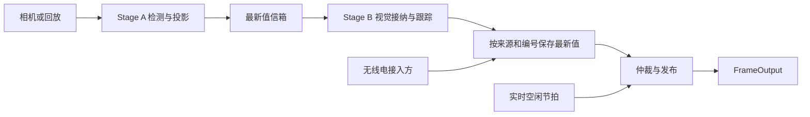

# JGRadar 架构（2026-10-19）

本项目包含相机/录像输入、检测、身份与跟踪、定位、视觉与无线电仲裁，以及结构化输出。
当前不含完整裁判串口发送应用和 GUI。实拍内外参由使用者标定；EGA 录像参数只用于它的录像。

实时源默认使用 ThreadedEventLoop：视觉生产线程与仲裁消费线程分开。
视觉没有新包或包已超龄时，消费线程仍调用 StageB.tick，判断无线电和视觉看门狗。
回放源默认单线程，使用录像时间线，便于得到确定的结果。
Stage B 的 process/tick 由同一个消费线程串行调用；外部无线电线程只写共享缓冲区。

## 输入、检测与身份

- Frame 带采集时间和帧号，可以携带图像或预先计算的检测结果。
- 车辆检测 → 车辆 ROI 内装甲检测 → 装甲数字分类。
- ONNX 后端读取独立瓦片。动态批次沿 N 维堆叠；固定批次按模型声明处理，不把 768 像素拼图交给 192 像素网络。
- EGA 使用通用车辆 item、装甲 red/blue/dead、MobileNet 六类数字。分类器执行黑边补方、64×64 缩放及训练时归一化。
- Stage A 将同一车辆的颜色和数字组合成 R/B 编号；S 映射哨兵 7，Q 与灰色装甲不生成身份。
- 若模型已经给出合法完整编号，则保留其编号。
- 推理失败仍能降级，但检测器保留 inference_errors、last_error；Stage A 诊断输出各级错误计数。

config/vision_check.yaml 用于实拍检测预览，config/ega_replay.yaml 用于参考录像。
数字模型使用可选 infer-digit 依赖。其他检测后端仍为 stub/empty/onnx，未实现的 TRT/Torch 检测配置拒绝启动。

## 定位

相机模型、内外参与场地几何离线构建查找表。运行时取车框底边中点查表。

- ground_plane：射线与地面求交。
- mesh：射线先遇到可站立面才产生位置，遇到墙等遮挡面另行记录。
- 加载预计算表时校验标定、分辨率、模式和网格签名。
- 外参求解支持任意高度和方向的共面对应点；在局部平面求解后转回场地坐标。
- 对齐校验中任何已提供点的非有限误差都会导致质量检查失败，不从统计中删除。

## 跟踪与四态

物理车辆使用图像域与场地域的两个恒速滤波器。
原始跳变门和马氏距离门约束空间关联；单帧身份差异作为软代价，不再阻止纠错。
完整身份证据累计投票，数字在完整车类存在时只作印证。
匈牙利算法保留先求解、再拒绝超限配对的保守策略。

| 状态 | 含义 |
|---|---|
| measured | 得到已确认观测 |
| occlusion_hold | 短时未见，滤波预测 |
| blind_prediction | 长时未见，采用配置的战术航点 |
| missing | 没有可靠位置 |

进入重捕获后，Track.reacquiring 独立锁存等待状态。未连续达到 reacquire_hits 时，
不刷新最后已确认观测时间；中途漏检也不会经 HOLD 绕过确认门限。
卡尔曼预测分段覆盖完整物理时间，零时间不外推；重复或倒序视觉包在进入跟踪前拒绝。
无世界坐标的观测当前不进入 MultiTracker，这仍是现有功能边界。

## 融合与输出含义

LatestValueBuffer 按来源和编号保存最新值。传入空缓冲区或空信箱时保留原对象。
VisionSource 待消费数据按编号合并，Stage B 每包及时取走；身份退休时主动写 MISSING 撤回旧编号。

仲裁保留来源优先级、驻留和切换跳变约束，再应用位置误差门限。
预测误差包含滤波标准差的三倍、报告点相对滤波中心的偏移，以及计算后暂存期间的运动余量。
因此不能把远处战术航点配上原地滤波器的小误差直接上报。
没有新视觉包的 tick 只做仲裁/发布，不制造视觉观测，也不刷新视觉来源活跃时间。

| 字段 | 含义 |
|---|---|
| frame_seq / captured_at | 所关联的最新有效视觉帧；尚无视觉帧时序号为 -1 |
| publication_seq | 本次运行中递增的发布序号，包括没有新视觉帧的发布 |
| published_at | 发布判断时刻 |
| observed_at | 真正的采集/最后确认观测时间；MISSING 为判定时间 |
| source / track_id | 来源和物理轨迹编号 |
| position_std_cm | 滤波预测中心的标准差 |
| prediction_offset_cm | 报告点相对滤波中心的距离，参与误差判断 |

换来源时 observed_at 可以回退到较旧样本的真实时间，不进行人为抬高。
同来源有效观测时间不应倒退；发布顺序用 publication_seq/published_at 检查。
新字段为向后兼容的可选 JSON 字段，旧记录仍可读取。

## 配置和验证

配置未知键、重复键和错误类型在加载时拒绝。pipeline.mailbox_size 已接入装配。
原来没有生效的 track.pred_jump_px、track.prefilter_window 已移除，复制旧配置时需删除这两个键。

- tests/test_review_regressions.py：已知问题的组合回归。
- tools/replay_runner.py：已有检测结果或真实视频的流水线回放。
- tools/vision_preview.py：实拍、图片或录像检测预览，可保存数字分类记录；不代替跟踪和定位验收。
- out/fixes_20261019/verify_real_models.py：真实 EGA 权重、录像与回放标定的 CPU 验证。
- docs/fixes_20261019.md：本次修复和验证结果。

测试数量与通过结果以本次 pytest 日志为准。相机实拍稳定性、真实编号准确率、
位置误差、无线电实体链路与长期运行还需要按现场条件验收。
